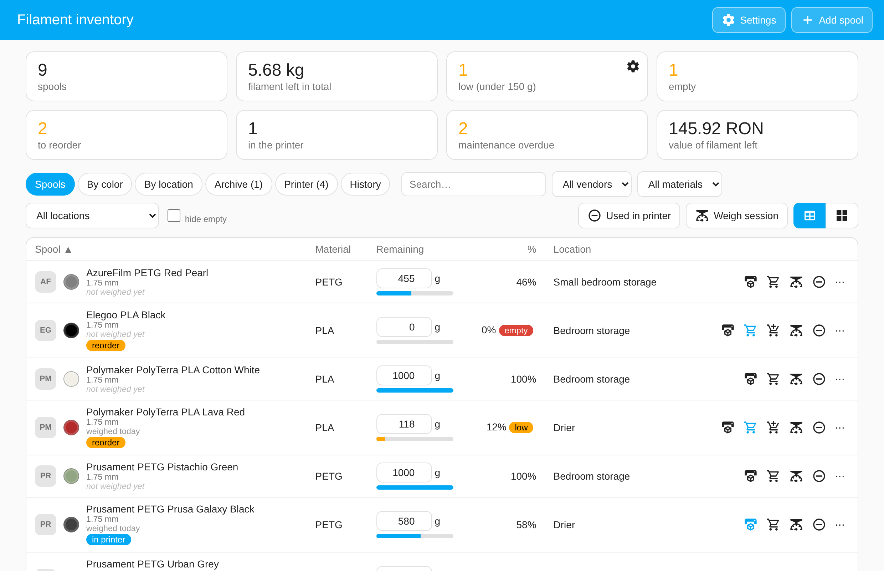
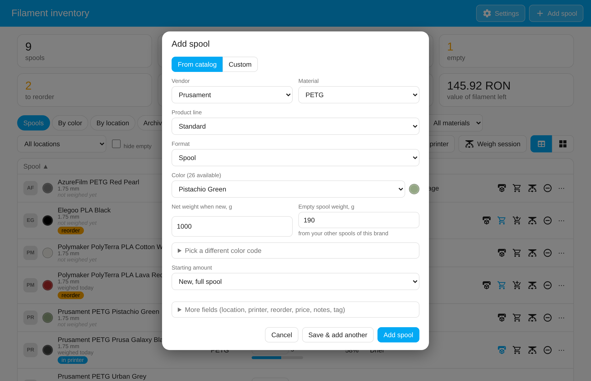
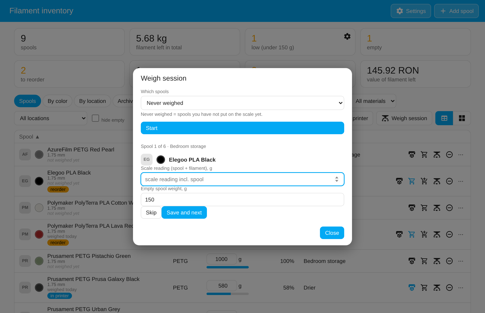
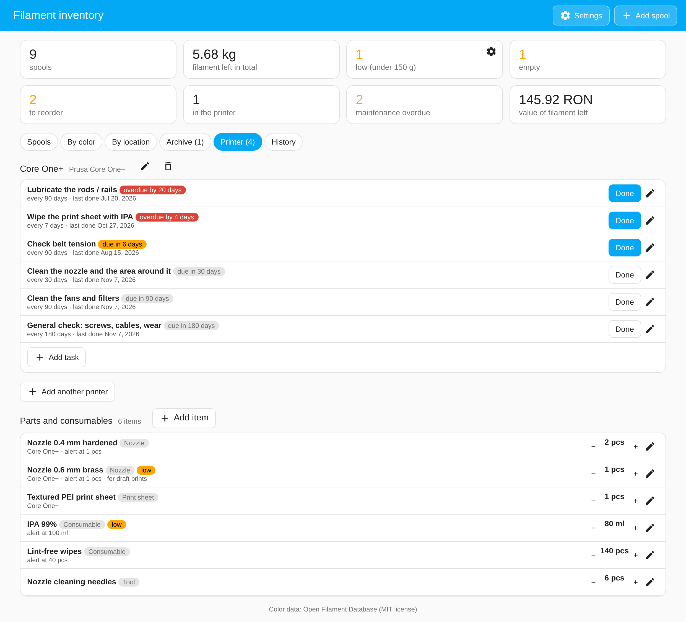
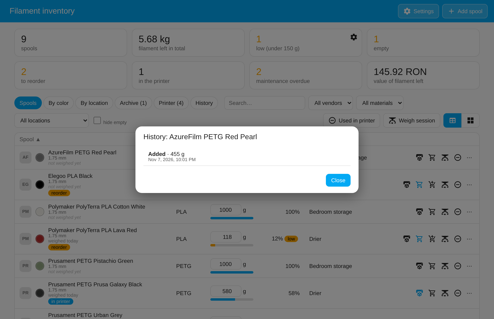
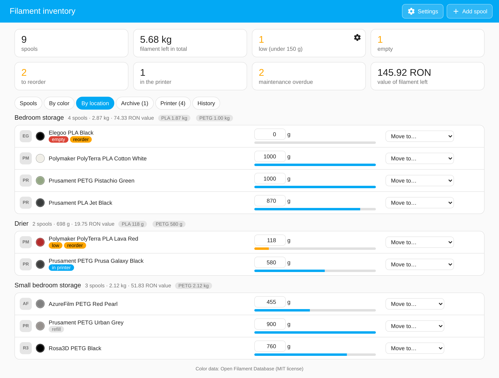
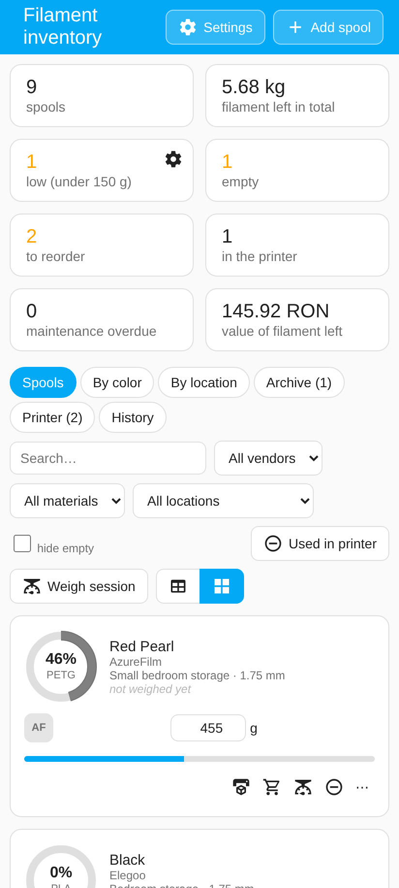

<p align="center"></p>

# Spool Inventory for Home Assistant

A local filament inventory for 3D printing, built as a Home Assistant custom integration.
No cloud, no extra server, no account. It adds a **Filament** entry to the sidebar, and every spool also
becomes a device with a sensor (grams left) for automations and dashboards.



## Features

- **Inventory**: every spool with vendor, material, color, remaining grams, price, location, notes.
  Table or card view, search and filters, edit remaining grams in place.
- **Catalog**: pick vendor, material and color from a built-in catalog (the whole
  Open Filament Database: about 150 brands, 14,700 colors), or add your own custom entries. Prusament refills (900 g) are supported.
- **Weigh session**: step through your spools, type the scale reading, press Enter. Warns about
  implausible readings.
- **Loaded in printer**, **Used in printer** (subtract a print's grams from the loaded spool),
  **reorder list** with a "bought another" button, **archive** for finished spools.
- **By color** and **By location** views, plus a **value of filament left** card with your currency.
- **Low and empty alerts**: notifications and events for automations.
- **Printer tab**: printers, maintenance tasks with intervals and overdue alerts, parts and consumables
  (nozzles, sheets, IPA, wipes...) with low-stock warnings and a shared shopping list.
- **History** of every change, with "Set back to" for wrong entries; **undo** after deleting.
- **Backups**: download or restore JSON, CSV export, automatic daily and pre-upgrade copies.
- Works on phones (cards layout) and in dark mode. Visible to every HA user; only admins can change data.

| Add a spool | Weigh session |
|---|---|
|  |  |

| Printer tab | History |
|---|---|
|  |  |

| Locations | Phone |
|---|---|
|  |  |

## Requirements

Home Assistant 2026.9 or newer. Developed and tested on a Raspberry Pi installation.

## Installation

### HACS (custom repository)

Repository: https://github.com/andrei20092222-sudo/Spool-Inventory

1. HACS > three-dot menu > **Custom repositories**.
2. Add `https://github.com/andrei20092222-sudo/Spool-Inventory`, category **Integration**.
3. Download **Spool Inventory**, then restart Home Assistant.

### Manual

Copy `custom_components/spool_inventory` into `/config/custom_components/` and restart Home Assistant.

### Setup

Settings > Devices & services > **Add integration** > **Spool Inventory**. Then reload the browser page so
the **Filament** sidebar entry appears. Updating keeps your data.

## Using the panel

- **Add spool**: *From catalog* (vendor, material, product line, color; color code, spool size and
  empty-spool weight are filled in) or *Custom*. Choose the starting amount: new full spool, known grams
  left, or scale reading including the spool. **More fields** holds price, location and notes.
- **Row buttons**: loaded in printer, reorder, bought another (reorder list only), weigh, use filament,
  and a "..." menu with edit, history, duplicate, archive, delete.
- **Weigh session** (toolbar): walks through never-weighed spools, all spools, or one location.
- **Used in printer** (toolbar): subtracts grams from the spool marked as loaded.
- **Settings**: low threshold (default 150 g), notifications, currency (default RON), storage locations,
  your own catalog, recently deleted spools, backup and restore.

Vendor logos are not shipped (they are trademarks). Without them each vendor gets a letter badge. To show
pictures, put your own images in `custom_components/spool_inventory/www/logos/` named `prusament.png`,
`azurefilm.png`, `polymaker.svg`, `rosa3d_filaments.png`, `raise3d.png`, `elegoo.png`, `buddy3d.png` for example (this are the filament brand that I use, so it's made around these), then reload.

## Actions

| Action | Target | What it does |
|---|---|---|
| `spool_inventory.add_spool` | none | Create a spool (returns `spool_id` and `name`) |
| `spool_inventory.weigh_spool` | spool sensor | Set remaining from a scale reading |
| `spool_inventory.consume_filament` | spool sensor | Subtract `grams` (never below 0) |
| `spool_inventory.update_spool` | spool sensor | Change any detail or weight |
| `spool_inventory.delete_spool` | spool sensor | Remove the spool, its device and sensor |
| `spool_inventory.list_spools` | none | Return spools as data (optional filters) |

```yaml
action: spool_inventory.add_spool
data:
  vendor: Prusament
  material: PETG
  color_name: Pistachio Green
  initial_weight: 1000   # filament on a new spool, g
  spool_weight: 201      # empty spool, g
  gross_weight: 742      # scale now, spool + filament -> 541 g left
  location: Bedroom storage
```

## Sensors

- One per active spool: state is grams left; attributes include `vendor`, `material`, `color_name`,
  `color_hex`, `remaining_percent`, `loaded`, `reorder`, `price`, `location`, `notes`. Archived spools have no sensor.
- `sensor.spool_inventory_total_filament`: total grams, with `breakdown`, `by_color`, `by_material`, `by_vendor`.
- `sensor.spool_inventory_spool_count`: number of spools, with `empty_spools`, `low_spools`, `loaded`, `to_reorder`.
- Maintenance overdue and low parts/consumables sensors for the Printer tab.

## Events

Use these as automation triggers (for example to send a phone notification):

| Event | When | Data |
|---|---|---|
| `spool_inventory_low` | a spool drops below the threshold | `spool_id`, `name`, `remaining_weight`, `threshold`, `location` |
| `spool_inventory_empty` | a spool runs out | same |
| `spool_inventory_task_due` | a maintenance task becomes due or overdue | task and printer details |
| `spool_inventory_item_low` | a part or consumable is at or below its minimum | item details |

```yaml
trigger:
  - platform: event
    event_type: spool_inventory_low
action:
  - action: notify.notify
    data:
      message: "{{ trigger.event.data.name }} is low: {{ trigger.event.data.remaining_weight }} g"
```

## Data and backups

Data lives in `/config/.storage/spool_inventory.spools`, so normal Home Assistant backups include it.
The format is versioned; before an upgrade changes it a copy is written to
`.storage/spool_inventory.backup_before_upgrade`, and a daily copy to `.storage/spool_inventory.backup_daily`.
Removing the integration keeps your data; adding it again restores it. The diagnostics download contains
spool and printer data but nothing else.

## Catalog

The built-in catalog is the whole [Open Filament Database](https://github.com/OpenFilamentCollective/open-filament-database)
(MIT): about 150 brands, 14,700 colors and 38 materials, 1.75 mm only. Pick a brand, material, product line and
color and the swatch, spool size and (where known) empty-spool weight are filled in. Seven brands (Prusament,
AzureFilm, Polymaker, Rosa3D, Raise3D, Elegoo, Buddy3D) have tidied product lines for PLA, PETG and TPU and come
first in the list; all others follow alphabetically. Something missing? Use *Custom*, and tick "Save to my catalog".
`tools/build_catalog.py` rebuilds `www/catalog.json` from a database checkout:
`python3 -I tools/build_catalog.py /path/to/open-filament-database`. Missing or wrong colors are best fixed
upstream in the database, so everyone benefits.

## Not included yet

Automatic deduction from a print (PrusaLink), NFC / OpenPrintTag tags, per-spool dashboard cards, drying tracker,
QR labels. `tag_id` is stored but unused.

## Development

```
pip install -r requirements-test.txt
ruff check .
pytest
```

## Disclaimer

Independent project, not affiliated with or endorsed by Prusa Research, Polymaker, AzureFilm, Rosa3D, Elegoo,
Raise3D, Buddy3D or Home Assistant. All names are trademarks of their owners. See `THIRD_PARTY_NOTICES.md`.

## License

MIT, see `LICENSE`. Changes per version: `CHANGELOG.md`.
